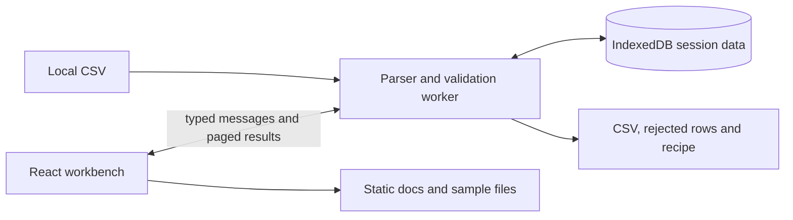

# ImportDesk — private CSV repair before an import

Status: proposed implementation · Priority: build first · Effort: 90–130 focused hours.

Read [shared engineering standards](ENGINEERING.md) and [research](RESEARCH.md). Their GitHub, licensing, CI, dependency and accessibility requirements apply here.

## 1. Problem, audience and useful outcome

A volunteer coordinator or small-business operator receives a spreadsheet export and needs to import it into another system. Column names differ, identifiers have leading zeroes, dates are ambiguous and duplicate rows produce rejected imports. Fixing a file in a spreadsheet is easy to get wrong and hard to repeat next month.

ImportDesk is a browser-only workbench that maps a CSV to a declared destination schema, explains problems, previews repairs and exports a validated file plus a reusable recipe. Files stay on the device. Its first concrete workflow is a community equipment inventory import: `asset_id`, `label`, `category`, `location`, `inspection_date` and `quantity`.

[OpenRefine](https://openrefine.org/) establishes the value of local cleaning and repeatable operations. This proposal's narrower benefit is an immediately usable browser flow for a known import schema. It is not a spreadsheet replacement, fuzzy entity-resolution platform or database admin tool.

### Discovery gate

Observe three people who recently cleaned an import file. Ask for a synthetic equivalent, destination field requirements, the last rejected import and how they verified correctness. Test a six-screen paper prototype. Proceed if at least two can identify a recurring task and complete the proposed flow without unexplained data loss. If users already solve it easily with a saved spreadsheet template, narrow to their hardest schema-validation case or contribute an adapter upstream.

Success targets: in a pilot, at least four of five participants repair the supplied 1,000-row sample without assistance; all exported rows satisfy the chosen schema; users can explain every changed column. Compare task time against their actual current method before claiming savings.

## 2. Scope and user journeys

### Alpha: one complete path

Import UTF-8 CSV → choose inventory schema → map columns → fix one validation type → preview changes → export clean CSV. The original is immutable. No accounts or server.

### V1 requirements

- CSV with comma, semicolon or tab delimiter; explicit user confirmation of detected delimiter and header row. Support quoted newlines and UTF-8 BOM. Reject undecodable content with a useful message; other encodings wait for a real request.
- Configurable destination schemas using a constrained JSON format: string, integer, decimal string, date-only, enum, required and unique. Preserve strings such as `000123`; no automatic number/date coercion.
- Mapping assistant suggests by normalized header names, but the user confirms ambiguous mappings. Show unmapped/duplicate columns and missing required fields before validation.
- Issues grouped by rule and column, with row/cell examples, counts and repair explanation. Supported transforms: trim whitespace, explicit enum mapping, explicit date-format conversion and setting a selected missing value.
- Review duplicate keys; choose the retained row or keep unresolved. No silent row deletion or fuzzy merging.
- Immutable original plus ordered transformation recipe. Undo/redo operates on recipe steps; a manual cell edit is a targeted operation, not an overwrite of source data.
- Export valid rows and a separate rejected-row report only after explicit confirmation. The default blocks a complete export while blocking errors remain. Include totals and reason codes.
- Download/import schema and recipe JSON; validate versions. Recipe import never executes code or accepts arbitrary regular expressions.
- Opt-in local session save, clear data and export backup. A sample dataset works immediately without uploading anything.

Out of scope: XLSX, million-row files, remote URL fetching, SQL, cloud sync, AI suggestions, arbitrary formulas, collaborative editing, automatic application imports and storing real user data on a server.

## 3. Interaction and visual design

Human: an operator comparing two exports during a busy workday. Task: decide which repairs are safe. Feel: precise and reversible, like an inspection workbench.

Domain vocabulary: source, destination, mapping, row, exception, preview, receipt. Color world: white paper, graphite labels, blue mapping pen, amber flagged cells, green accepted stamps. Signature: a fixed before/after cell inspector with the exact recipe step responsible for the change. This appears in issue detail, bulk preview, history, export summary and recipe replay.

Avoid a KPI dashboard, rainbow cell backgrounds and a full Excel-style editable grid. Lead with unresolved work and visible provenance.

| Screen/route            | Main content and action                                                               |
| ----------------------- | ------------------------------------------------------------------------------------- |
| `/`                     | Drop/select a file, choose sample or reopen a saved session; explicit local-only note |
| `/sessions/:id/map`     | Source preview on left, destination requirements on right, confirm mappings           |
| `/sessions/:id/review`  | Issue list, paginated rows, before/after inspector; apply scoped repair               |
| `/sessions/:id/history` | Ordered recipe steps with effects and undo/redo                                       |
| `/sessions/:id/export`  | Valid/rejected counts, spreadsheet safety mode, download receipt                      |

Desktop: 240px issues rail, flexible table, 320px inspector; collapse inspector to an accessible dialog below 1100px. Mobile: issue list → row detail → repair preview, rather than forcing a three-pane grid into 360px. Use actual table markup with 50-row pagination by default. Optional virtualized read-only view comes only after measured need; keep the paginated accessible mode.

Design tokens: `--paper: #F8FAFC`, `--ink: #172033`, `--mapping: #1D4ED8`, `--exception: #92400E`, `--accepted: #166534`; verify actual color pairs before release. Use a system sans for controls and a monospace face for raw data/identifiers. Body 14px desktop/16px mobile; headings 20/28px; 4px spacing grid, 12px workbench padding, 8px control gaps. Border-led depth, 4/8px radii, tabular numerals. Buttons explain scope: “Trim 124 selected values,” not “Fix all.” Announce operation completion once; do not read thousands of cell changes aloud.

## 4. Architecture and repository layout

Stack: React, TypeScript, Vite, [Papa Parse](https://www.papaparse.com/docs), Dexie/IndexedDB, Zod, Vitest, Playwright. Use a Web Worker for parsing, validation and transforms; no backend or hosted database. React owns presentation and commands, not a second full copy of the dataset. The default worker store is memory; IndexedDB is used only after the user chooses to save the session. The two storage adapters expose the same narrow row/page contract.



```text
src/app/                 routes and error boundaries
src/features/import/     file validation and mapping
src/features/review/     issue list, table, inspector
src/features/history/    recipe and undo/redo
src/features/export/     export review and downloads
src/domain/              schemas, rules, transforms, result types
src/worker/              protocol, job loop, cancellation
src/storage/             Dexie schema and migrations
src/ui/                  tokens and composed primitives
fixtures/                synthetic malformed and valid CSVs
docs/                    decisions, pilot notes, measurements
```

State ownership: URL holds session ID, current view and non-sensitive filters; component state holds open panels; a reducer owns workflow/selection/recipe cursor; IndexedDB holds saved data; the worker owns the active processing job. No duplicate global store for data already owned by the worker. Session IDs are local opaque UUIDs; a copied URL does not share data.

### Data contracts

| Entity              | Essential fields/invariants                                                                                  |
| ------------------- | ------------------------------------------------------------------------------------------------------------ |
| `Session`           | id, schemaVersion, originalFileHash, originalName, importOptions, createdAt; original never mutated          |
| `SourceRow`         | sessionId, stable rowId, sourceLine, cells as strings; physical line and logical CSV row distinguished       |
| `DestinationSchema` | version, fields with stable IDs, type, required, enum values, unique keys                                    |
| `RecipeStep`        | id, operation kind, columnId, explicit parameters, selected stable row IDs or reproducible filter; versioned |
| `ValidationIssue`   | rowId, columnId, ruleCode, severity, rawValue, proposedValue; no HTML                                        |
| `ExportReceipt`     | schema/recipe version, source hash, accepted/rejected totals, safety mode, timestamp                         |

Worker requests are discriminated unions: `IMPORT`, `VALIDATE`, `PREVIEW_STEP`, `COMMIT_STEP`, `GET_ROWS`, `EXPORT`, `CANCEL`. Every message has request ID, session ID and revision. Replies have matching identifiers and `progress`, `result`, `cancelled` or typed `error`. Ignore results from obsolete revisions. Cancel cooperatively between chunks; terminate and restart a stuck worker with the saved session still intact.

### Correctness algorithm

1. Parse in bounded chunks; place original rows in the selected memory or opt-in persistent store in batches only after file/options confirmation. Do not write raw data to IndexedDB before consent.
2. Normalize header matching only; preserve source values. Empty versus missing values remain distinct in the model.
3. Run pure rules on transformed values. A date requires a chosen source format; `01/02/2026` remains ambiguous until declared.
4. Preview the selected operation, show affected count and sample diffs, then commit a recipe revision.
5. Apply steps deterministically in order. Store explicit selected row IDs for manual selections so later filters cannot change operation scope.
6. Undo adjusts the cursor; a new edit after undo discards the redo branch only after confirmation. Recompute affected columns where possible, then run global uniqueness rules.
7. Revalidate the final snapshot at export. Export revision and receipt must match; disable simultaneous mutation during snapshot creation.

Initial limits: 20 MiB input, 100,000 logical rows, 50 columns and 64 KiB/cell. Stop at the first exceeded limit with no misleading complete-result state. Load only current page data into React. If realistic pilot files exceed limits, profile first and revise the envelope rather than asserting unlimited scale.

## 5. Privacy, persistence and failure handling

No file payload leaves the browser; no external fonts, analytics, URL previews or remote schema fetches. Use a CSP restricted to the application/worker needs. Rendering file content is text-only. Network inspection must confirm that importing/exporting sends no data. Persist sessions only after opt-in; show storage use and delete controls. Treat browser storage as recoverable convenience, not guaranteed backup. See MDN references T9/T10.

CSV formula injection: offer a prominently explained spreadsheet-safe export that escapes cells beginning with spreadsheet formula triggers, including leading control/whitespace variants. Show what changes. A raw machine-import export is a separate deliberate choice; do not silently change identifiers or rely on CSV quoting alone to neutralize formulas. Include malicious fixtures in export tests.

Quota failure leaves the current in-memory session readable, clearly marked unsaved, with export available. Refresh after failure must not claim persistence. A malformed recipe/import is rejected with a path-specific error. A corrupted session offers raw backup download and recovery, not silent reset. Set schema migration tests before shipping a changed IndexedDB version.

## 6. Tests and measurable acceptance

| Risk                     | Verification                                                                                                                                                       |
| ------------------------ | ------------------------------------------------------------------------------------------------------------------------------------------------------------------ |
| Silent data changes      | Golden fixtures: leading zeroes, decimals, quoted newlines, BOM, empty cells, duplicate headers, locale dates                                                      |
| Non-deterministic repair | Same original + recipe produces identical normalized output; undo/redo restores previous values; stable row identity                                               |
| Wrong export             | Round-trip parse exported CSV; accepted + rejected count equals source count; no dropped or extra rows                                                             |
| Slow main thread         | 100k×20 synthetic fixture: progress updates, cancellation responds within 500ms; no processing-attributable main-thread task over 200ms on documented test machine |
| Stale worker result      | Change revision while validation runs; old result cannot replace latest issues                                                                                     |
| Browser persistence      | Reload, failed IndexedDB transaction, storage unavailable and migration from previous schema                                                                       |
| Accessibility            | Complete sample mapping/repair/export by keyboard; error focus and table headers verified manually                                                                 |
| Export security          | Formula-trigger corpus, untrusted HTML values and malformed recipe schemas                                                                                         |

Performance goals: first preview of 10,000×20 data within two seconds on a documented ordinary laptop; paginated filter response p95 below 150ms on that fixture; initial application JS below 250 KiB gzip excluding deferred worker/parser. These are proposed budgets, to be revised transparently after baseline measurements. Test browser smoke on Chromium, Firefox and WebKit; imports must not depend on File System Access API.

## 7. Implementation backlog and dependencies

| Milestone            | Issue-sized deliverables                                                                              | Exit gate                                           | Hours |
| -------------------- | ----------------------------------------------------------------------------------------------------- | --------------------------------------------------- | ----- |
| M0 Discovery/design  | Interview guide; synthetic inventory schema; mapping/review wireframes; ADR on local-only processing  | Target workflow and acceptance fixture agreed       | 6–10  |
| M1 Vertical alpha    | Repo/CI; parser worker; file limits; explicit mapping; one required-field rule; CSV export            | One sample completes end-to-end; no network payload | 18–24 |
| M2 Repair engine     | Versioned recipes; preview/commit; trim/enum/date operations; duplicate review; undo/redo             | Deterministic fixture suite passes                  | 24–32 |
| M3 Durable workbench | IndexedDB opt-in; migrations; issue navigation; responsive/table semantics; quota/cancel states       | Reload and keyboard journeys work                   | 20–28 |
| M4 Release           | Cross-browser checks; performance evidence; manual a11y; pilot fixes; docs, starter issues and v1 tag | Shared release checklist plus pilot report          | 22–36 |

Dependencies: schema and stable row IDs precede recipes; worker revisions precede cancellation/replay; export validation precedes bulk repair UI; schema migrations precede any persisted beta release. Finish M1 before extracting extra packages.

## 8. Public contribution design

Publish a sample schema specification and a fixture guide. Six first issues: (1) semicolon/BOM fixture and expected parse, (2) improved missing-required-column message, (3) keyboard focus regression test for inspector close, (4) synthetic inventory schema with documentation, (5) recipe-format documentation example, (6) forced-colors styling for issue markers. No task requires real customer data or a cloud account.

Keep transforms behind a closed, typed operation union in v1. Third-party executable plugins are deferred; accepting a new transform requires validation rules, deterministic tests and export implications. Use labels by area: parser, mapping, repair, export, accessibility.

## 9. Deployment, operations and portfolio proof

Deploy static output to Cloudflare Pages with a free subdomain. Include fixtures under 1 MiB in the demo; generate stress fixtures locally. Add immutable caching for hashed assets, revalidation for HTML and suitable security headers. No service worker in v1: offline reopening adds a separate cache-upgrade problem without improving the primary privacy promise.

Smoke test the deployed synthetic import and export. Keep the previous deployment available for rollback and test saved-session backward compatibility. Provide a user-controlled diagnostic report containing versions, limits and error codes only; filenames and cell values are excluded.

Demo story: import a deliberately messy inventory, preserve an ID beginning with zeroes, resolve an ambiguous date, undo a bulk repair, export and replay the recipe on a second sample. Case study: explain worker design, immutable operations, accessible tables and honest scale limits. v1 is useful when an operator can prepare a real permitted file without your help; screenshots alone do not meet the gate.
